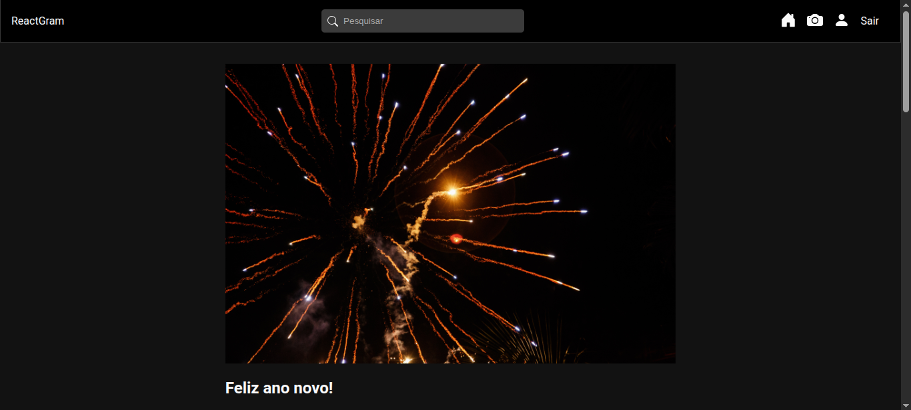

# ReactGram

  
  
  
  
  
  
  
  

<h2><a>Objetivo</a></h2>

O objetivo desse projeto foi desenvolver uma aplicação Full Stack completa, simulando funcionalidades principais do Instagram (postagem de fotos, likes, comentários e perfil de usuários). O foco principal foi consolidar conhecimentos nas stacks (MongoDB, Express, React e Node.js) utilizando TypeScript no frontend para garantir tipagem estática e Redux para gerenciamento de estados complexos.

<h2><a>Explicando o código</a></h2>

O projeto é dividido em duas partes principais integradas:

<ul>
  <li><strong>Back-end (API):</strong> Construído com Node.js e Express. Utiliza arquitetura MVC (Model-View-Controller). A segurança é feita via JWT (JSON Web Tokens) para autenticação e bcryptjs para criptografia de senhas. O upload e armazenamento de imagens é gerenciado pelo Multer. O banco de dados é o MongoDB (Atlas), conectado via Mongoose.</li>
  

  <li><strong>Front-end:</strong> Desenvolvido com React, Vite e TypeScript. Utiliza Redux Toolkit para gerenciar o estado global da aplicação (autenticação do usuário e feed de fotos). A comunicação com a API é feita através de Hooks personalizados e fetch nativo.</li>
</ul>

 
  
  
  

